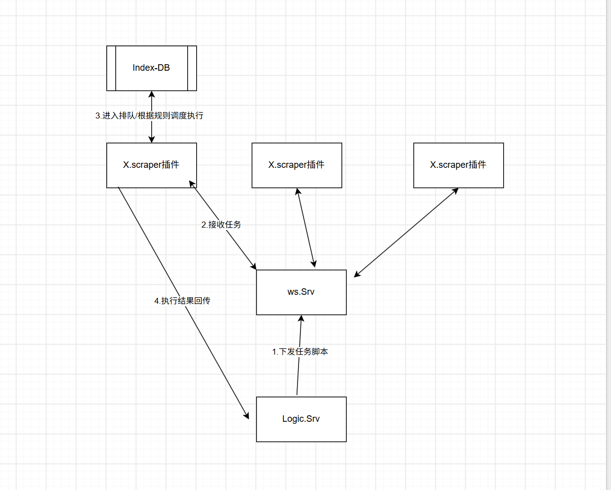
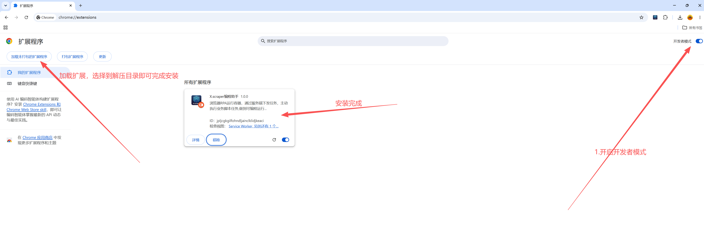
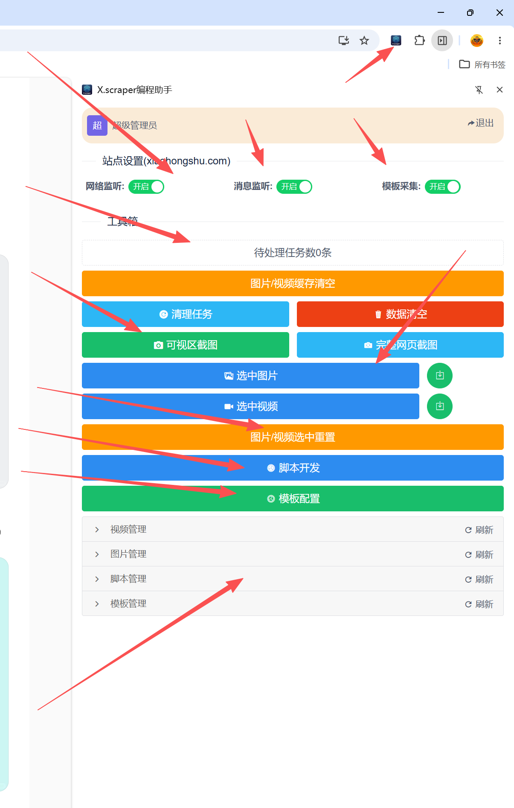
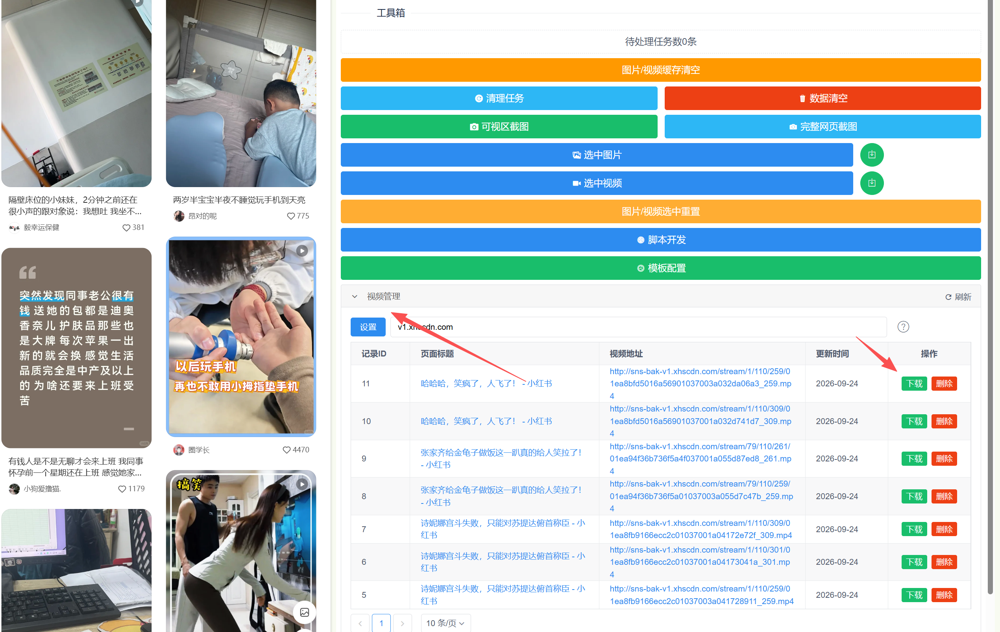
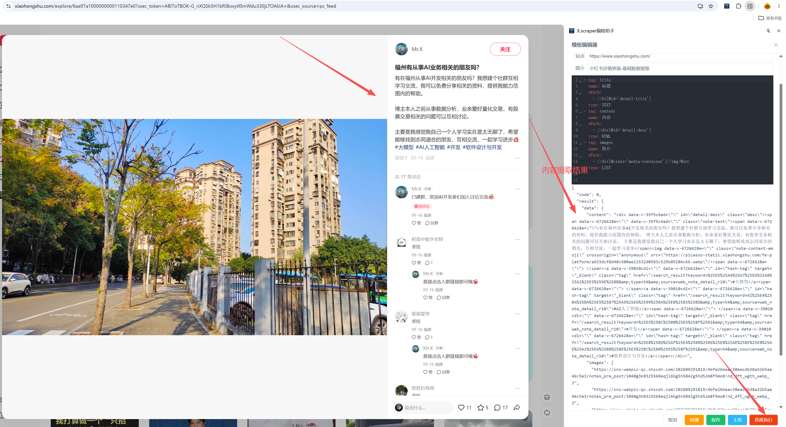
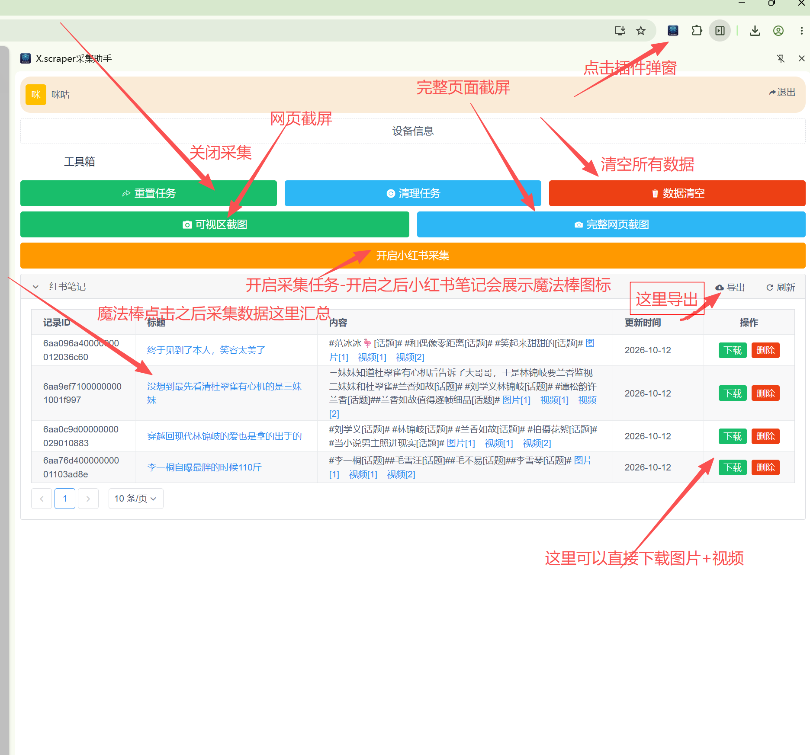

# X.scarper chrome插件

## X.scarper,此工具仅用js脚本的自动化执行部署技术学习研究...
## 本软件数据存储都在用户本地indexDB当中，请放心使用.

整体架构设计图，主体思想是想借助浏览器的插件能力动态的调度执行脚本；从而实现RPA功能以及数据采集功能。


## 下载X.scraper.zip 解压, 具体参考安装流程

## 功能介绍


### 账号登录/注册 --可以使用邮箱或者手机号注册,注册之后请务必记住密码

### 站点设置 可以自主的设置是否开启站点的http请求监听拦截，开启context-script消息通知，开启模版采集(开启之后会注入wasm解析脚本服务)

### 待处理任务数 --统计的时候后端异步派发任务给前端执行的时候会有这个数值，默认为0

### 执行图片采集的时候下载完图片同时会记录这些图片地址备用，执行视频采集的脚本之后, 后续浏览视频页面会自动抓取视频地址，想下载的时候可以直接下载；如果不想要了可以直接一键清空


### 可视区截图和完整网页截图 功能就是截图当前侧边的网页；需要开启站点的消息通知才能使用此功能

### 脚本开发，这里可以根据对方定时话书写脚本，例如网页的RPA脚本\采集脚本 等等！！！
脚本编辑可以直接测试试跑，满足要求之后可以保存或者上传到云端，后续要使用的时候只要登录相同的账号就可以把脚本同步下来继续复用;当然这期间也可以将脚本分享给其他人使用.脚本开发之后本地也会存储一份，在需要执行的站点可以直接点击运行脚本即可完成制定化的脚本任务

范例视频地址提取脚本


### 模版开发，这里主要是配置了一个wasm模版解析器，它将会根据你配置的默认解析页面数据提取.
模版解析器支持xPath，正则, cssPath(htmlQuery选择器),每种选择器可以配置多个根据顺序执行，匹配到结果即结束。编辑完模版可以直接运行测试；将会提取侧边的html做解析数据提取，并返回结果

配置的模版是yaml文档,格式如下:

```
- tag: title
  name: 标题
  xPath:
    - //h1[@id='detail-title']
  type: TEXT
- tag: content
  name: 内容
  xPath:
    - //div[@id='detail-desc']
  type: HTML
- tag: images
  name: 图片
  xPath:
    - //div[@class='media-container']//img/@src
  type: LIST
```

### 小红书采集，执行开启小红书采集之后，打开小红书会展示一个魔法棒的按钮，小红书的详情界面点击按钮即可采集，采集的数据在侧边即可查阅


## ⚠️ 重要声明（Disclaimer）

本软件（以下简称“本工具”）仅供学习、研究及合法合规的数据采集用途开发。


